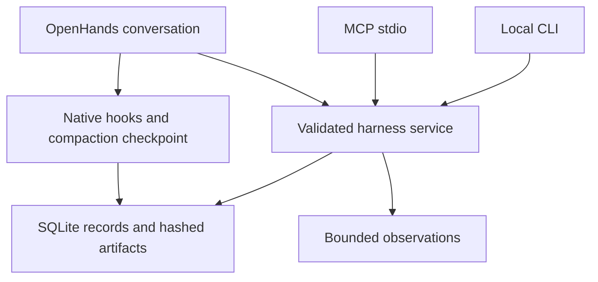

# Research harness implementation

This branch adds a persistent, bounded research harness to `openhands-tools`.
The CLI, MCP stdio server, and OpenHands SDK tool share validated operations and
state. The core and runnable demonstration make no model requests, so you can
test them without an API key.

The AgentMemory integration adds six shared memory operations, portable host
configuration bundles, explicit operator instructions, and an opt-in skill
selection evaluator. See [AgentMemory integration](AGENTMEMORY_INTEGRATION.md)
for source provenance, migration details, examples, and acceptance limits.

The packaging follow-up also includes the workflow skill in the workspace source
bundle used for Docker builds and in the frozen Agent Server's data files. These
are separate packaging paths from the tools wheel; see
[packaging follow-up verification](../.pr/research-harness-packaging-followup.md).

The source is [Harness Engineering for Vulnerability Research](2026-unprompted-harness-engineering.pdf),
with a [complete Markdown transcription](Vulnerability_Harness_Engineering/Vulnerability_Harness_Engineering.md).
The workshop describes responsibilities and examples rather than publishing one
fixed reference implementation. This package implements those responsibilities
using Python import inventories, public repository metadata, and an owned local
fixture. The exploitation case studies are not executable package features.

PDF SHA-256: `81843e4a0359c602a201ba7bfaa222a6ad6a63ec729059a5ce7823a9b8473fe9`.

## 1. First run: no model or API key

For your existing checkout:

```bash
export SDK_REPO="$HOME/Harness_Security_Research/software-agent-sdk"
cd "$SDK_REPO"
git switch feature/security_harness
git pull --ff-only origin feature/security_harness
uv sync --frozen --dev

"$SDK_REPO/.venv/bin/python" -I \
  "$SDK_REPO/examples/01_standalone_sdk/60_research_harness/main.py"
```

Adjust `SDK_REPO` if necessary. The normal development setup, `make build`, also
installs the workspace and pre-commit hooks.

The example records two inventories with equal import counts but different
declarations, compares content, queries the saved snapshot, validates the local
fixture, builds bounded context, updates an assessment with evidence references,
and reopens persisted state. It also saves and recalls an authored decision with
its evidence references, then injects that note into bounded context. Assertions
check actual values. Successful output
includes `"ok": true`, added/removed imports, fixture cleanup, resumed thread
version `2`, and `EXAMPLE_COST: 0.0`.

The example removes temporary source, state, and artifacts after completion.
Its only network activity is its own loopback fixture. Use the persistent setup
below to keep research records.

## 2. Architecture and PDF mapping



The feature is additive. Existing SDK tools and default agent behavior are
unchanged. The scoped conversation helper selects the research tool, workflow
skill, native hooks, and checkpointing condenser.

| PDF responsibility | Implementation | Modules |
| --- | --- | --- |
| Validation, pp. 9–13 | Owned loopback fixture; verify HTTP response, instance identity, normal item response, socket closure, and cleanup. | `fixture.py`, `core.py` |
| Integrations, pp. 14–18 | Optional bounded public GitHub metadata, source/time, raw response digest, actual outcome. | `network.py`, `_http_worker.py` |
| Interfaces, pp. 19–25 | Shared strict schemas and service dispatch for CLI, MCP, and SDK. | `commands.py`, `service.py`, `cli.py`, `mcp_server.py`, `definition.py` |
| Memory, pp. 26–31 | Versioned questions and evidence plus authored notes, decisions, constraints, lessons, provenance, pinning, expiry, history and bounded lexical retrieval. | `models.py`, `agentmemory.py`, `store.py`, `artifacts.py` |
| Context, pp. 32–36 | Actual text under an exact UTF-8 budget, one read snapshot, separately labeled memory, saved selection manifest and explicit omissions. | `context.py` |
| Telemetry, pp. 37–40 | Transactional SQLite ledger, correlated interface events, bounded retrieval, derived resumable JSONL. | `store.py`, `service.py`, `views.py` |
| Skills, pp. 41–44 | Packaged `research-review` workflow using native SDK progressive disclosure. | `workflow.py`, `skills/research-review/SKILL.md` |
| Deterministic tools, pp. 45–49 | Static Python import parsing, file hashes, coverage/exclusions, partial results, declaration-content comparison. | `inventory.py`, `snapshots.py` |
| Hooks, pp. 50–53 | Six actual SDK events, operation validation, context injection, condenser checkpoints, plus a separately tested Claude Code protocol adapter. | `hooks.py`, `hosts.py`, `condenser.py`, `session.py` |
| Oracles, pp. 54–56 | Exact queries over validated saved import snapshots with provenance/completeness. | `snapshots.py` |

Module paths are relative to
[`openhands-tools/openhands/tools/research_harness`](../openhands-tools/openhands/tools/research_harness/).
The oracle is an import-snapshot oracle, not the PDF's Kubernetes RBAC corpus.
It reports facts without inferring exploitability. Fixture readiness applies
only to the built-in application.

### Packaging the workflow asset

`research-review/SKILL.md` is loaded from disk beside `workflow.py`. Its bytes
must survive each packaging layer: `openhands-tools/pyproject.toml` includes it
in the tools wheel, the root `MANIFEST.in` includes it in the workspace source
distribution, and `agent-server.spec` includes it at the corresponding frozen
package path. The packaging regression checks apply the actual manifest and
PyInstaller collection calls and compare the resulting file bytes and location.

## 3. Persistent CLI setup

The operator fixes workspace and state paths at startup; operations cannot
replace them. The workspace must exist. The directories must be disjoint,
with neither containing the other. For a small first review:

```bash
export RESEARCH_WORKSPACE="$SDK_REPO/openhands-tools/openhands/tools/research_harness"
export RESEARCH_STATE="$HOME/.local/state/openhands-research/sdk-harness"

research() {
  "$SDK_REPO/.venv/bin/python" -I -m openhands.research \
    --workspace "$RESEARCH_WORKSPACE" \
    --state "$RESEARCH_STATE" "$@"
}

research schema
research schema inventory
research thread.create '{"question":"Which Python imports are declared here?","conditions":{"scope":"local package import declarations"},"next_action":"Record an inventory"}'
```

Copy `record.id` from the creation result:

```bash
RESEARCH_THREAD="thread_REPLACE_WITH_RETURNED_ID"
research inventory "{\"thread_id\":\"$RESEARCH_THREAD\"}"
research fixture "{\"thread_id\":\"$RESEARCH_THREAD\"}"
research context "{\"thread_id\":\"$RESEARCH_THREAD\",\"max_bytes\":4096}"
research run.list "{\"thread_id\":\"$RESEARCH_THREAD\",\"limit\":10}"
research evidence.list "{\"thread_id\":\"$RESEARCH_THREAD\",\"limit\":10}"
```

`openhands-research` is the equivalent console command. Absolute Python with
`-I -m openhands.research` prevents working-directory shadowing of the installed
launch module. CLI `schema` and `schema inventory` take no JSON object; ordinary
operations take JSON or `--json-stdin`. Exit codes: `0` success, `1` observed
unsuccessful result, `2` invalid input/storage error, `130` handled interruption.
Normal results use JSON stdout.

### Inspect evidence and update the assessment

Observations return `run_id`, `evidence_id`, and `artifact_sha` plus a compact
summary. Copy returned references into these commands:

```bash
RESEARCH_EVIDENCE="evidence_REPLACE_WITH_RETURNED_ID"
RESEARCH_SHA="REPLACE_WITH_64_CHARACTER_ARTIFACT_SHA"
research evidence.get "{\"evidence_id\":\"$RESEARCH_EVIDENCE\"}"
research artifact.read "{\"digest\":\"$RESEARCH_SHA\",\"offset\":0,\"limit\":4096}"
research thread.get "{\"thread_id\":\"$RESEARCH_THREAD\"}"
research schema thread.update
```

Read slices at `next_offset` until `eof`; respect `encoding` (`utf-8` or `base64`).
Large service responses can return `output_artifact_sha` instead. The
[example's `read_json` helper](../examples/01_standalone_sdk/60_research_harness/main.py)
shows complete retrieval.

Read the current version before updating. For a newly created, unchanged thread,
pass edited JSON of this shape to `thread.update`:

```json
{
  "thread_id": "thread_REPLACE_WITH_RETURNED_ID",
  "expected_version": 1,
  "assessment": "Describe observed facts and cite evidence IDs and digests actually inspected.",
  "next_action": "Review recorded exclusions before extending the assessment."
}
```

A stale version raises a conflict; reload and reconcile. Closing requires
`closure_reason` and `reopen_condition`. New processes with the same paths reopen
saved records. SDK transcripts and research threads are separate records.

| Area | Shared operations |
| --- | --- |
| Threads | `thread.create`, `thread.get`, `thread.list`, `thread.update`, `thread.history` |
| Outcomes | `run.get`, `run.list` |
| Evidence | `evidence.get`, `evidence.list` |
| Authored memory | `memory.remember`, `memory.get`, `memory.update`, `memory.forget`, `memory.recall`, `memory.history` |
| Observations | `inventory`, `github`, `fixture`, `compare`, `query` |
| Context/inspection | `context`, `artifact.read`, `events`, `events.export` |

`compare` takes `before_sha` and `after_sha`; `query` takes `artifact_sha` and
optional exact `module`, `name`, and `path` filters. Both require `thread_id`.
Schemas provide the complete contract. Query execution can succeed on a partial
saved dataset: inspect `dataset_complete`, coverage, and omissions. Comparison
ignores line movement, counts duplicate declarations, and reports incompatible
Python parser versions. Equal counts do not establish content equality.

## 4. MCP connection

An MCP client launches this command and communicates over stdio:

```bash
"$SDK_REPO/.venv/bin/python" -I -m openhands.research \
  --workspace "$RESEARCH_WORKSPACE" --state "$RESEARCH_STATE" mcp
```

The single `research_harness` tool takes `operation` and `arguments`. Discover
schemas with `{"operation":"schema","arguments":{}}`. For Codex CLI:

```bash
codex mcp add openhands-research -- \
  "$SDK_REPO/.venv/bin/python" -I -m openhands.research \
  --workspace "$RESEARCH_WORKSPACE" --state "$RESEARCH_STATE" mcp
codex mcp list
```

This follows [official Codex MCP documentation](https://developers.openai.com/codex/mcp)
and installed CLI help. These are instructions: this change does not modify
Codex or Claude settings. Other clients use their supported local-command config.

MCP exposes operations and state; it does not replace the host agent loop or
install OpenHands hooks, skills, or condenser behavior into the host. Model usage
remains subject to the host provider/account. The server makes no LLM requests
and provides no authentication bridge. Locate the packaged workflow with:

```bash
"$SDK_REPO/.venv/bin/python" -I -m openhands.research skill-path
```

The SDK helper loads it automatically. MCP alone does not install host skills.
`host-config` produces a new review bundle for Codex, Claude Code, or Claude
Desktop, with host-specific MCP settings, the packaged skill, and setup notes.
Claude Code bundles can also include SessionStart, PreCompact and SessionEnd
hooks for an existing thread. See the integration guide for commands and the
distinction between protocol testing and actual host dispatch.

## 5. Complete OpenHands conversation integration

Supply an already configured `LLM` and existing thread. The helper wires the
tool, workflow skill, hooks, SDK persistence, and condenser checkpoint:

```python
from pathlib import Path

from openhands.sdk import LLM
from openhands.tools.research_harness.session import create_research_conversation


def review_with_llm(llm: LLM, workspace: Path, state_dir: Path, thread_id: str) -> None:
    conversation = create_research_conversation(
        llm=llm, workspace=workspace, state_dir=state_dir, thread_id=thread_id,
        operator_instructions=(
            "Review saved Python import declarations. Preserve source files "
            "and cite the recorded evidence and its limitations."
        ),
        max_iteration_per_run=20,
        max_budget_per_run=0.50,
    )
    try:
        conversation.send_message(
            "Resume the tracked review, inspect recorded evidence "
            "and limitations, and update the next action."
        )
        conversation.run()
    finally:
        conversation.close()
```

Construction makes no model request. `run()` and the default summarizing condenser
use the supplied LLM. A custom `RollingCondenser` can be passed as `condenser=`;
the checkpoint adapter wraps it. Model authentication/billing remain caller config.
The explicit instruction text is trusted caller configuration. Ambient workspace
instruction files remain disabled in this scoped helper. Iterations and the
SDK-reported cost can be bounded; cost checks occur between requests, so this is
not a hard provider billing cap.

The helper checks currently discoverable user/project plugins and rejects ambient
plugins before construction, leaving settings unchanged. This does not protect
against concurrent configuration changes. CLI, MCP, and the tool in custom SDK
sessions remain available.

| Lifecycle entry | Behavior |
| --- | --- |
| `SessionStart` | Build and inject actual bounded thread context. |
| `UserPromptSubmit` | Record minimal lifecycle metadata. |
| `PreToolUse` | Validate tool set/arguments; emit native denial for invalid actions. |
| `PostToolUse` | Record minimal tool metadata. |
| `Stop` | Record the lifecycle event. |
| `SessionEnd` | Record the event when the conversation closes. |
| Condenser entry points | Save a manifest and `hook.pre_compact` before sync/async condensation or hard-reset attempts. |

`hook.pre_compact` is an adapter event, not a native SDK `PreCompact` hook. It
records an attempt, not delegate success. Tests cover ordering, no-op thresholds,
failures, serialization, and sync/async paths. Some lifecycle hooks are advisory;
service validation and selected tools enforce their own constraints. Generated
hooks use isolated Python loading. The hook ledger excludes raw prompts/tool
bodies; SDK history retains ordinary events. Hooks are not an OS sandbox.

## 6. Evidence and execution semantics

State holds `state.sqlite3`, content-addressed artifacts, and optional SDK
history. SQLite is authoritative; JSONL exports are derived pages. Record mutations
and lifecycle events share a transaction. Threads are versioned, and terminal
run transitions cannot be applied twice.
Opening a schema-v1 store transactionally migrates it to schema v2, retaining
existing records and adding memory tables. Older harness versions reject the new
schema; preserve a consistent backup before migration if rollback is needed.

Observations start a run before working, persist artifact/evidence, then record
the actual terminal outcome. Failures and ordinary interruptions retain available
observations and limitations. Evidence includes status at capture; check the
current outcome before claiming completion. Context uses a coherent SQLite read
snapshot and includes current outcomes.

Artifacts are immutable through the API and digest-checked on read. Context
returns exact text, byte count, selection, and omissions; its manifest includes
the text and selection decisions, including older records outside the candidate
window. Raw artifacts and telemetry are retrieved only when requested.

`events`, `events.export`, and `artifact.read` do not audit their own reads, so
pagination does not continually extend the ledger. Ordinary interface events have
correlation IDs and argument-artifact references. Submitted arguments, notes,
artifacts, and SDK transcripts can contain sensitive data; their content and
filesystem access remain operator responsibilities.

Cancellation signals owned workers and drains cleanup. Network work has a
parent-enforced total deadline. MCP can acknowledge cancellation before the
handler finishes draining; the handler waits for cleanup before exiting. A hard
process kill can leave `running` state. After confirming the worker stopped:

```bash
research recover run_REPLACE_WITH_ABANDONED_ID "Worker stopped; operator verified it is no longer running"
```

Recovery is operator-only, not agent-facing. Opening state does not automatically
classify a running worker as abandoned.

## 7. Bounds and scope

| Resource | Bound/rule |
| --- | --- |
| Arguments | 16 KiB canonical JSON, strict fields, finite values |
| Records | 64 KiB; run input/result fields each 16 KiB |
| Artifacts | 1 MiB each, verified on read |
| Inline response | 64 KiB; larger results saved as artifacts |
| List page | At most 100 requested records, bounded output and continuation |
| Artifact slice | 1–4,096 bytes |
| Context | 512–16,384 UTF-8 bytes; default 8,192; newest 1–50 candidates, default 32 |
| Memory notes | Text 1–8,192 chars; required source 1–2,048 chars; at most 16 tags and 32 same-thread evidence references; shared argument byte limit still applies |
| Memory retrieval | Query at most 512 chars; 1–100 results; 1–500 loaded candidates, default 200; at most 49,152 serialized bytes; explicit omissions |
| Memory in context | At most 20 retrieved notes, default 8; previews consume at most one third of the total context budget |
| Inventory | 500 files, 256 KiB/file, 8 MiB total input, bounded traversal/output, 5-second cooperative budget |
| Query/comparison | At most 100 rows or change groups per side, bounded selected bytes, explicit omissions |
| GitHub | Opt-in public endpoint, no credentials/redirects/retries, 15-second worker deadline, 256 KiB body |
| Hooks | 256 KiB input, 30-second generated command timeout |

Inventory includes tests and reports hidden/vendor directory, non-Python,
symlink, and special-file exclusions. Anchored POSIX reads never import or execute
workspace code. Parse errors/limits retain incomplete results. Start with a small
package: the whole SDK may exceed the file bound. Cooperative budgets do not make
filesystem calls hard-real-time.

Enable public metadata with `--allow-github` before the CLI subcommand, or
`allow_github=True` in the service/helper. Call `github` with `thread_id` and
`repository`, such as `AhmadQasim881/software-agent-sdk`. This does not enable
arbitrary destinations or private repository authentication.

Verification covers Linux, local SDK conversations, and real MCP stdio processes.
The real local Agent Server also passed readiness, identity, authenticated normal
operations, and owned-process cleanup; see [local validation](../.pr/research-harness-local-validation.md).
The follow-up also verified real server-side MCP memory reads and native SDK
conversation configuration across a server restart; see
[server memory verification](../.pr/research-harness-remote-memory-verification.md).
Direct `RemoteConversation.execute_tool()` remains unsupported. Native execution
through the model-driven server loop is a distinct acceptance gate.

An actual source archive and frozen server binary now preserve the skill asset,
and the frozen server passed readiness, authentication and tool-catalog checks.
Docker execution, OS isolation, deployment to another host, and complete frozen
subprocess/hook behavior still require their corresponding acceptance checks.
The fixture is an owned readiness check, not a
general launcher or isolation boundary. API immutability cannot protect data from
another process with the same filesystem permissions. Queries report recorded
facts without vulnerability classification or exploit reproduction.

## 8. Verification

See the latest [completion follow-up](../.pr/research-harness-followup-verification.md),
[staged verification](../.pr/security-harness-verification.md) and
[installed-wheel verification](../.pr/research-harness-wheel-verification.md)
for actual commands and outcomes. From the repo root:

```bash
OPENHANDS_SUPPRESS_BANNER=1 LITELLM_LOCAL_MODEL_COST_MAP=True \
  uv run --frozen --no-sync pytest tests/tools/research_harness \
    tests/tools/test_init.py tests/tools/test_preset_default.py -q

OPENHANDS_SUPPRESS_BANNER=1 LITELLM_LOCAL_MODEL_COST_MAP=True \
  uv run --frozen --no-sync pytest tests/examples/test_examples.py \
    --run-examples -k 'research_harness or directory_example_is_discovered' -q
```

Tests exercise SQLite, CLI subprocess restart, MCP stdio/cancellation, native
hooks, real SDK conversation events, memory migration and concurrent writes,
host adapter commands, fixture cleanup, and package assets. LLM
transport is scripted: no paid provider was used, and live-model workflow
selection quality is not established. The cost-map flag avoids an unrelated
LiteLLM import-time network lookup.

`evaluate-skill` runs relevant and unrelated natural requests in separate local
SDK conversations when the operator provides a model and an explicitly named
credential variable. It records actual skill invocation, completion, cost, and
cleanup; missing credentials produce a blocked result with zero calls. This is
a two-case acceptance smoke test, not a general skill-quality benchmark.

The live public GitHub attempt failed at DNS resolution here and was recorded
as failed. Controlled HTTP/worker tests verify behavior; no successful live
external response is claimed.

For extensions, add strict schemas, shared dispatch, bounded observations with
provenance, and appropriate success/failure/partial/cancellation tests. Keep
context selection separate from artifacts, and host lifecycle wiring separate
from shared operations.

### Reproduce the server-side memory check

The development recipe uses the maintained Agent Server verification CLI to
launch an authenticated owned server, read scoped memory through MCP, restart
the server, reopen the native SDK configuration, and clean up its private state:

```bash
.venv/bin/python -I .pr/research-harness-remote-memory-check.py
```

It requires the installed development dependencies but makes no model request.
Its result distinguishes server-side MCP reads from native model-driven tool
execution. The committed evidence report contains the actual exchanges and
cleanup observations from the successful run.

### Branch acceptance workflow

The [Research harness acceptance workflow](../.github/workflows/research-harness-acceptance.yml)
runs on relevant changes pushed to this fork's `feature/security_harness` branch
and supports manual dispatch. It runs the complete harness suite, baseline tool
checks, packaging regressions and the no-model example. It then builds a standard
tools wheel and installs it in a fresh runtime using the committed dependency
lock. The SDK dependency remains editable from the same checkout; the tools
package must be installed from the wheel.

The [installed-package runner](../.github/scripts/verify_research_harness_install.py)
checks source/wheel/installed file equality, module origins, locked dependency
versions, all six memory operations, conflict handling, context bounds, CLI/MCP
persistence and generated host bundles outside the checkout. It also makes one
bounded, unauthenticated metadata observation of this public fork on ordinary
pushes. Manual dispatch can disable that live check. The workflow uses read-only
repository permissions and uploads its test and installation reports even when
an acceptance step fails.

To reproduce the installed-package check after preparing a runtime and wheel:

```bash
python .github/scripts/verify_research_harness_install.py \
  --python /absolute/runtime/bin/python \
  --checkout /absolute/software-agent-sdk \
  --wheel /absolute/wheels/openhands_tools-1.60.1-py3-none-any.whl \
  --report /absolute/reports/installed-wheel.json \
  --runtime-kind fresh-locked \
  --github-repository AhmadQasim881/software-agent-sdk
```

Omit `--github-repository` for local-only checks. Use `--runtime-kind
copied-runtime` when the runtime is a copy of an existing environment. The report
preserves successful local checks when a later live observation fails. The local
copied-runtime result does not establish that a fresh dependency install passed;
inspect the workflow result and its evidence for that acceptance gate.
